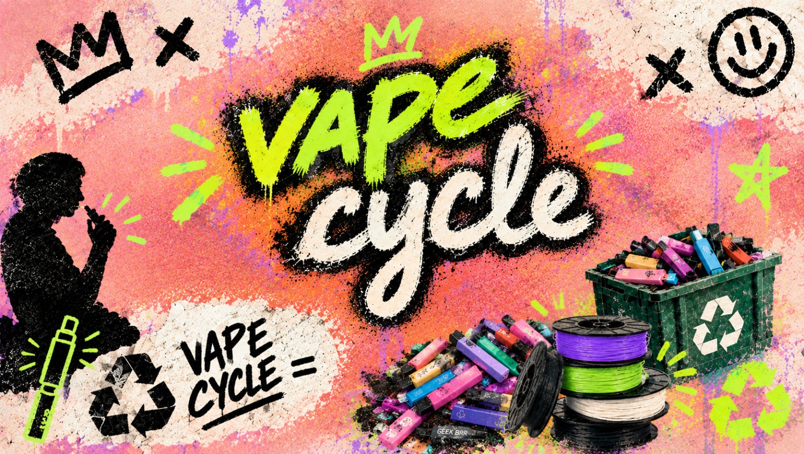

  

  

  
  
  
  

**VapeCycle** es un anteproyecto de **innovación social** que propone un sistema universitario de
recolección, clasificación y disposición segura de **vapeadores desechables** dentro de la Universidad EIA.
El objetivo no es solo reciclar: es que el residuo se convierta en **materia prima** (plástico → filamento
de impresión 3D) y en **aprendizaje** que permanezca en la comunidad universitaria.

  

## Introducción

Los vapeadores desechables se han convertido en un producto de uso frecuente, especialmente entre
jóvenes y estudiantes universitarios. Solo en el Reino Unido se estima que cada semana se descartan
varios millones de estos dispositivos y en Estados Unidos la cifra ronda los **500.000 al día**;
sin embargo, aunque están diseñados para usarse únicamente durante un tiempo corto, sus componentes
**no desaparecen** cuando el dispositivo se agota.

El problema principal es que muchas personas no saben cómo disponer correctamente de estos
dispositivos o simplemente no cuentan con un punto cercano para entregarlos a entidades que se
encarguen de desecharlos. Por esta razón, los vapeadores terminan mezclándose con residuos
ordinarios o reciclables, donde las baterías pueden dañarse, generar incendios durante la recolección
o el tratamiento de residuos y llegar a liberar materiales que no deberían llegar al ambiente. A su
vez, también se pierden recursos que todavía podrían aprovecharse, como ciertos plásticos, metales y
componentes electrónicos.

A partir del análisis de esta situación, este anteproyecto tiene como objetivo proponer la creación de
**VapeCycle**, una iniciativa de innovación social orientada en la recolección responsable de
vapeadores desechables dentro de la Universidad EIA. La propuesta busca instalar un sistema de
recolección, clasificación y disposición segura de los componentes peligrosos, especialmente las
baterías de litio y los elementos electrónicos, mediante la entrega a gestores autorizados —haciendo
la aclaración de que el proyecto **no interviene directamente** con estos componentes peligrosos, sino
que su manejo se limita a canalizarlos hacia gestores especializados—. El único material que se evalúa
para un aprovechamiento directo dentro del campus es el **plástico**, que podría transformarse en
filamento de impresión 3D.

Más allá de reciclar vapeadores, la idea busca convertir estos residuos en una oportunidad de
aprendizaje, participación y creación de valor dentro de la comunidad universitaria, en línea con los
principios de la innovación social, debido a que no se trata solo de resolver un problema ambiental
sino de que ese aprendizaje y ese valor permanezcan en quienes lo generan. Si las pruebas técnicas lo
permiten, el plástico recuperado podría transformarse en filamento para fabricar prototipos, material
educativo, piezas funcionales u objetos para proyectos estudiantiles, de forma que este residuo se
convierta en un recurso útil para toda la comunidad universitaria.

  

## Contexto de la situación

Los vapeadores desechables se han vuelto muy populares debido a que son accesibles, fáciles de
conseguir y están diseñados para utilizarse y desecharse rápidamente. Al formar parte del consumo
diario, muchas personas los arrojan a la basura como si fueran residuos normales, sin considerar la
variedad de componentes que contienen.

Sin embargo, un vapeador es un **residuo mixto o compuesto**, ya que reúne en un solo dispositivo
materiales como plástico, piezas metálicas, circuitos electrónicos, restos de líquido químico y una
batería de litio. Esta combinación hace que su disposición inadecuada represente no solo la pérdida de
materiales que podrían aprovecharse, sino también riesgos ambientales y de seguridad. Por esta razón,
estos dispositivos no deben desecharse junto con los residuos comunes ni con el reciclaje de casa:
requieren procesos específicos para su desarme y clasificación.

Otra de los principales problemas es la falta de cultura ciudadana con el manejo de este tipo de
residuos electrónicos, junto con la falta de contenedores especializados cerca de los lugares donde se
consumen. En consecuencia, una gran cantidad de estos vapeadores termina mezclada con la basura,
generando riesgos a lo largo de la cadena de gestión de residuos. Entre los más preocupantes se
encuentra el peligro para recicladores y recolectores, debido a que las baterías de litio pueden ser
aplastadas durante la compactación de los residuos en camiones o plantas de tratamiento. Esto puede
provocar cortocircuitos e incendios que ponen en riesgo su integridad física.

Además, la disposición inadecuada de los vapeadores representa un importante desperdicio de recursos.
Materiales como los metales, el litio y los plásticos podrían recuperarse y reincorporarse a la cadena
productiva, pero al ser desechados sin un tratamiento adecuado se pierden. A esto se suma el impacto
ambiental y sanitario, ya que, cuando estos dispositivos llegan a los rellenos sanitarios o quedan
abandonados al aire libre, sus componentes plásticos pueden permanecer durante largos períodos sin
degradarse, mientras que los líquidos químicos residuales pueden filtrarse hacia el suelo y las
fuentes de agua.

  

## Marco teórico

### Innovación social

¿Qué hace que algo sea innovación social? No es la tecnología. Es **a quién le sirve**. Phills y
Emerson (2008) lo dicen claro: se trata de resolver un problema social o ambiental **mejor de lo que
ya se resuelve**, y que ese valor se quede en la comunidad, no en un privado.

VapeCycle calza ahí. El problema es real: los vapeadores desechables se están acumulando en el campus
y nadie los maneja bien. Nada de eso se le paga a un externo tampoco: quien recolecta y aprovecha el
material es la misma comunidad universitaria (estudiantes, personal de aseo, laboratorios). Y no es
una campaña de un día. La meta es que quede algo: menos residuos peligrosos, materiales recuperados y
gente que entendió la economía circular porque **la vivió**, no porque alguien se la explicó en una
charla de media hora.

### Economía circular

Toda la propuesta se sostiene técnicamente en la economía circular. La Ellen MacArthur Foundation
(2024) la resume en tres puntos: diseñar para que no se genere residuo desde el inicio, mantener los
materiales circulando el mayor tiempo posible y regenerar los sistemas naturales. Nada de extraer,
usar y botar. Aquí el residuo no es el final del camino, sino una **falla de diseño** que se puede
corregir.

Con los vapeadores esto baja a tierra rápido. El vapeador agotado deja de ser basura: pasa a ser
materia prima. Cada parte se separa según le toca —lo biológico, lo técnico o lo que necesita
disposición segura— en vez de tirarlo todo junto en la misma caneca. Y el ciclo se cierra ahí mismo,
en el campus: el plástico vuelve como filamento y la universidad lo usa. Nada de mandarle el problema
a un tercero que no devuelve nada.

### Gestión de residuos electrónicos y de baterías de litio

Un vapeador desechable es un **RAEE**. Tiene plástico, metal, circuitos y una batería de litio
(Ellen MacArthur Foundation, 2018). Eso cambia todo. El WEEE Forum (2021) es claro: este residuo no
puede ir con la basura normal ni con el reciclaje doméstico, porque cada parte se aprovecha distinto.

Lo más delicado es la batería. La Agencia de Protección Ambiental de Estados Unidos ha visto que las
baterías de litio dañadas —cuando se aplastan o se compactan junto con otra basura— causan incendios
en plantas y camiones de reciclaje con bastante frecuencia (EPA, 2021a). Su recomendación es tajante:
nunca botarlas con la basura ni con el reciclaje normal; hay que entregarlas a un gestor autorizado
(EPA, 2021b). Por eso VapeCycle define **desde el diseño mismo, y no después**, que las baterías y los
circuitos no se tocan dentro del proyecto: se separan y se entregan a gestores especializados. Solo el
plástico se queda en el ciclo interno de la universidad.

  

## Propuesta de solución

En primer lugar, de entre los problemas que estábamos sopesando, nos llamó la atención el tema de los
vapeadores y, como es, en varias dimensiones, uno de los problemas más grandes de nuestra generación,
nos pareció pertinente el resolver al menos uno de sus gradientes: el de la acumulación resultante de
estos.

Los vapeadores, de entre muchas de las cosas que los hacen dañinos, es su naturaleza desechable. En
las manos de un usuario no duran mucho, por lo cual, luego de un muy corto periodo de tiempo de ser
producidos, terminan en algún lugar de desechos, incluso si fueron depositados en un lugar adecuado
para el reciclaje. Esto, ya que el vapeador cuenta con varios elementos, de los cuales no todos son
reciclables, con lo cual una solución principal comienza a asomarse: **hacernos cargo de los desechos
producidos por los vapeadores**.

Sin embargo, eso es solo atacar las consecuencias del problema, no la causa. Por lo cual es importante
también tener en cuenta campañas de concientización, alianzas con empresas, contenedores especiales y
reciclaje plástico en general, y un sistema propio de cómo hacerlo en la universidad. Tras analizar
una por una las ideas, revisamos qué combinación de estas nos puede dar el mejor resultado con el
menor *input* financiero, del cual se escogió un **sistema universitario de recolección y
aprovechamiento**, porque combina educación, acción y creación de valor local.

### El sistema: recolección, separación y aprovechamiento

1. **Recolección** → contenedores seguros y señalizados donde estudiantes y personal puedan dejar
   vapeadores gastados.
2. **Separación**
   - Baterías de litio → disposición según las recomendaciones del [WEEE Forum](https://weee-forum.org/).
   - Componentes electrónicos y metálicos → recicladores.
   - Plásticos → limpiar y clasificar por tipo.
3. **Aprovechamiento de componentes** → los materiales que no se usan directamente (circuitos, metales,
   etc.) pueden entregarse a gestores que paguen por ellos, ya que tienen metales reutilizables, lo que
   ayuda a financiar el proyecto y a apoyar la economía circular.
4. **Procesamiento del plástico** → se tritura y, si las pruebas lo permiten, se convierte en filamento
   para impresión 3D.
5. **Producción de filamento** → mediante extrusión controlada, siempre que las pruebas demuestren que
   es de buena calidad, para usarlo en las mismas impresoras 3D de la universidad.
6. **Uso del filamento** → prototipos de proyectos, material educativo, piezas para proyectos
   estudiantiles y objetos funcionales o decorativos para espacios universitarios.

### Manejo responsable de baterías y electrónicos

- Las baterías de litio **no se procesarán** en el proyecto: se guardan de forma segura y se entregan a
  gestores autorizados.
- Los componentes electrónicos también se entregan a recicladores especializados.
- Así se evitan riesgos de incendio y se garantiza un tratamiento adecuado.

### Validación del plástico para filamento

El proyecto **no asume** que todo el plástico sirva para filamento. Antes de producir a gran escala se
hará:

- Identificación del tipo de plástico en los vapeadores recolectados.
- Evaluación de sus propiedades (temperatura, resistencia).
- Pruebas piloto con pequeñas cantidades para ajustar el proceso.
- Solo si las pruebas son exitosas se producirá más filamento.

### Viabilidad económica

- Los materiales recuperables (electrónicos, metales, plásticos no usados) pueden entregarse a gestores
  que paguen por ellos.
- Ese dinero puede usarse para cubrir costos de contenedores, equipos de trituración y extrusión, y
  logística.
- Se pueden buscar alianzas con oficinas de sostenibilidad, laboratorios y empresas interesadas en
  economía circular.

### ¿Por qué esta solución?

Se eligió frente a otras ideas debido a que combina varios factores que vemos como importantes a la
hora de lidiar con un problema: creemos que es más importante atacar los problemas de raíz y, para eso,
es fundamental que la prevención, la educación y las acciones concretas sean parte de la solución. Además,
esta idea **integra valor local** (filamento y objetos para la universidad), es escalable y se alinea con
los valores de la innovación social y la economía circular, fundamentales para los tiempos que corren.

  

## Posible impacto

| Dimensión | Resultado esperado |
|---|---|
| **Ambiental** | Menos residuos en vertederos, menos plástico nuevo, manejo seguro de baterías y mayor compromiso con el medio ambiente y con nuestra propia salud |
| **Social** | Más conciencia, participación de la comunidad, oportunidades de aprendizaje y fortalecimiento de los vínculos sociales que nos definen como comunidad EIA |
| **Económico** | Ingresos por materiales recuperados, ahorro en filamento y posibilidad de alianzas y financiación |

  

## Referencias (APA 7)

- Ellen MacArthur Foundation. (2020). *The circular economy | Definition & model explained.* https://www.ellenmacarthurfoundation.org/topics/circular-economy-introduction/overview
- Ellen MacArthur Foundation. (2024). *Circular economy principles.* https://www.ellenmacarthurfoundation.org/circular-economy-principles
- Ellen MacArthur Foundation. (2018). *Circular consumer electronics: An initial exploration.* https://www.ellenmacarthurfoundation.org/circular-consumer-electronics-an-initial-exploration
- Environmental Protection Agency. (2021). *Analysis of lithium-ion battery fires in waste management and recycling.* https://www.epa.gov/system/files/documents/2021-08/lithium-ion-battery-report-update-7.01_508.pdf
- Environmental Protection Agency. (2021, 2 de junio). *The importance of sending consumers' used lithium-ion batteries to electronic recyclers or hazardous waste facilities.* https://www.epa.gov/recycle/importance-sending-consumers-used-lithium-batteries-electronic-recyclers-or-hazardous
- Material Focus. (2026, 29 de julio). *6m vapes and pods are thrown away every week despite the vape ban* [Nota de prensa]. https://materialfocus.org.uk/?press-releases=6m-vapes-and-pods-are-thrown-away-every-week-despite-the-vape-ban
- National Recycling. (2025, 9 de octubre). *Vape waste statistics 2025.* https://nationalrecycling.co.uk/vape-waste-statistics-2025/
- Phills, J., & Emerson, J. (2008). *Defining social innovation.* Stanford Social Innovation Review.
- RSC Sustainability. (2026). *Improving 3D printing sustainability in academic research: A PLA recycling initiative at Université de Montréal.* RSC Sustainability. https://pubs.rsc.org/en/content/articlehtml/2026/su/d5su00959f
- WEEE Forum. (2021). *Recommendations tackling fires caused by lithium batteries in WEEE.* https://weee-forum.org/wp-content/uploads/2021/07/Tackling-fires-caused-by-batteries-in-e-waste.pdf

  

## Equipo

Anteproyecto **VapeCycle** — asignatura de *Innovación social*, 2026.

> Los nombres de los integrantes y de la docente se dejan fuera de este archivo a propósito.

  

